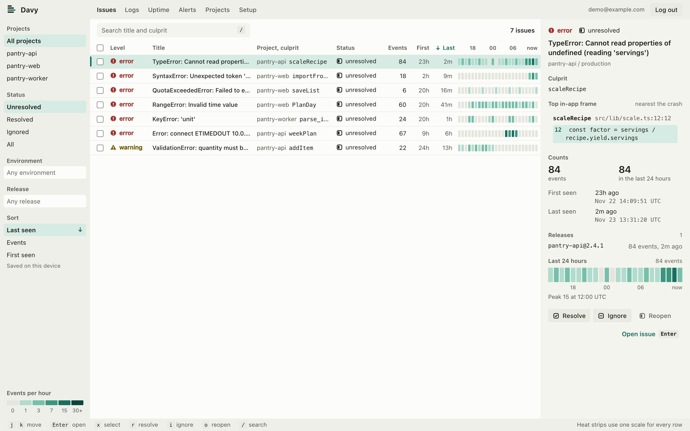
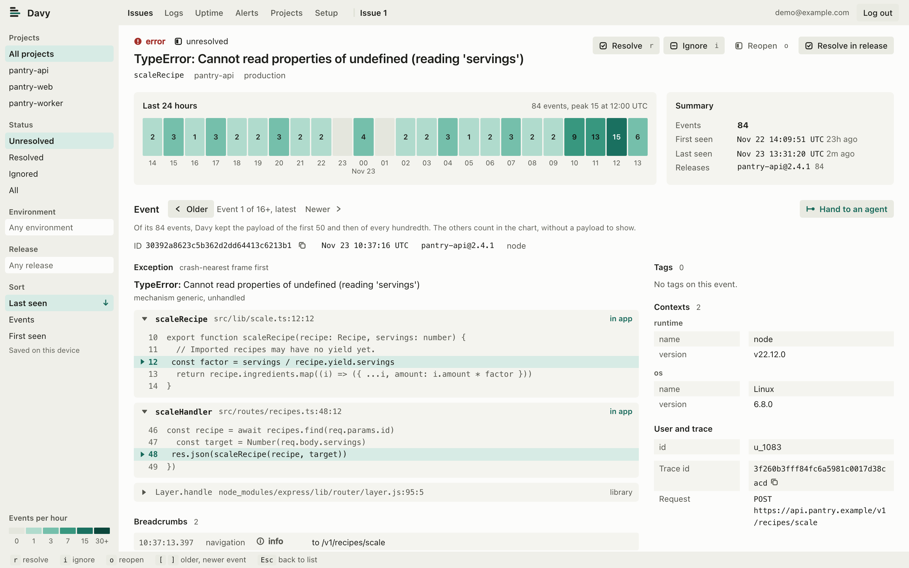
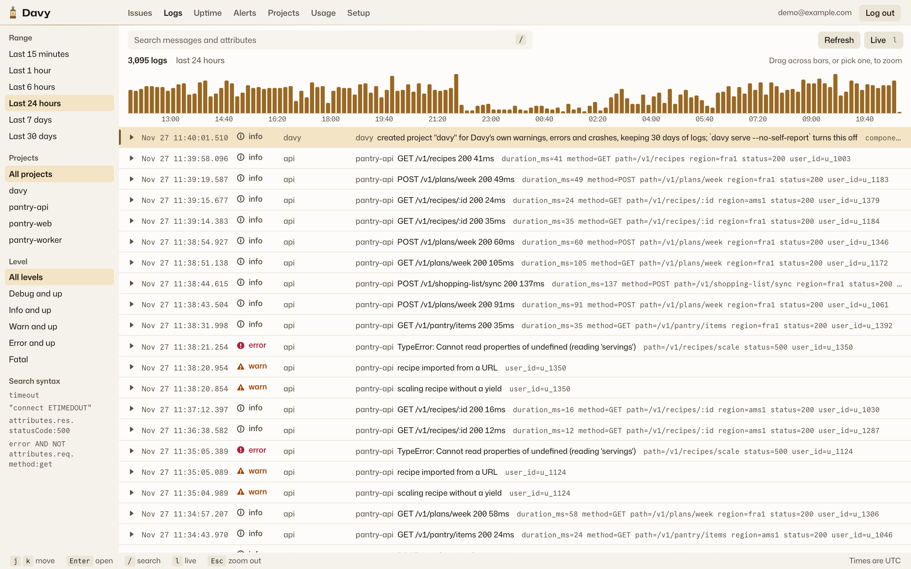

<h1 align="center">Davy</h1>

<p align="center">
  Error tracking, logs, uptime and alerts in one self-hosted binary.<br>
  Your existing Sentry SDK and log shippers send to it unchanged.
</p>

<p align="center">
  <a href="https://github.com/dominikzabcik/davy/actions/workflows/ci.yml"></a>
  <a href="https://github.com/dominikzabcik/davy/releases/latest"></a>
  <a href="LICENSE"></a>
</p>

<picture>
  <source media="(prefers-color-scheme: dark)" srcset="docs/images/issues-dark.png">
  
</picture>

Davy replaces Sentry and Better Stack for a team that wants to run its own. It is one Rust binary of about 30 MB with SQLite and Tantivy inside. There is no database server, queue or cache to run next to it. Apps switch by changing the DSN or the log token, not their code. Coding agents read errors and logs and mark issues fixed over MCP.

## What it does

- **Errors.** Takes what the official Sentry SDKs send, groups it into issues and reopens an issue when it comes back in the release that fixed it or a newer one. Minified browser stacks turn back into source through maps uploaded with `sentry-cli`. What users write in the SDK's feedback widget shows up on the issue, and the SDK's client reports say what it dropped before sending. Release health counts the sessions the SDKs send, so crash-free sessions and users show per release.
- **Logs.** Takes logs from Logtail shippers (pino, Vector, Fluent Bit), OpenTelemetry and Sentry's logger, with full-text search, a histogram and live tail. Logs next to an error show up on the error.
- **Uptime.** HTTP checks with status and keyword, and heartbeats for cron jobs, which also take the cron check-ins of the Sentry SDKs (`Sentry.withMonitor`) with their crontab schedule and time zone.
- **Alerts.** A notice when an issue is new or regressed and when a monitor goes down or comes back, never on every event. To webhooks (signed), Slack and e-mail.
- **Agents.** An MCP server with eleven tools: `schema`, `sql`, `search_logs`, `count_logs`, `release_health`, `issue_context`, `mark_fixed`, `submit_feedback`, `connect_project`, `project_status` and `set_retention`. Every operator step is also a CLI command with `--json`.
- **Web UI.** Triage issues from the keyboard, read stack traces and breadcrumbs, search logs. Light and dark.

## Quick start

### Docker

```sh
docker volume create davy
docker run --rm -v davy:/data ghcr.io/dominikzabcik/davy \
  setup --data /data --public-url http://127.0.0.1:8000 --listen 0.0.0.0:8000
docker run -d --name davy --restart unless-stopped \
  -p 127.0.0.1:8000:8000 -v davy:/data ghcr.io/dominikzabcik/davy serve --data /data

docker exec davy /davy project create my-app --data /data      # prints the DSN
docker exec davy /davy user add you@example.com --data /data   # prints a sign-in link
```

Open the link, set a password, and put the DSN into `Sentry.init({ dsn })`. The UI is at http://127.0.0.1:8000/ui/. [docs/docker.md](docs/docker.md) adds TLS, MCP, backups and upgrades.

### Binary

Builds for Linux (static, x86_64 and aarch64) and macOS (Apple silicon and Intel) are on the [releases page](https://github.com/dominikzabcik/davy/releases/latest). On a Mac with Apple silicon:

```sh
FILE=davy-aarch64-apple-darwin
curl -fsSLO "https://github.com/dominikzabcik/davy/releases/latest/download/$FILE"
curl -fsSLO "https://github.com/dominikzabcik/davy/releases/latest/download/SHA256SUMS"
grep " $FILE\$" SHA256SUMS | shasum -a 256 -c -   # on Linux: sha256sum -c -
install -m 755 "$FILE" ./davy

./davy setup --data ./data --public-url http://127.0.0.1:8000
./davy serve --data ./data &
./davy project create my-app --data ./data
./davy user add you@example.com --data ./data
```

### With a coding agent

For a server with systemd and TLS, or a Mac that keeps Davy running, give your agent this prompt in the app's repository:

```text
Install Davy on this machine and connect this app to it.
Follow docs/install.md in https://github.com/dominikzabcik/davy from top to bottom.
```

The agent asks for the public URL and, optionally, an SMTP server. It installs and checks the binary, sets up the service and TLS, connects the SDK in your app and adds MCP for itself. `davy doctor` tells it what is still wrong and the command that fixes it. CI follows the same page in Debian with systemd, every step but the download.

## Connect your app

Run `davy connect my-app --data /var/lib/davy --sdk node` for JSON with the DSN, SDK setup and a test-event command. Add `--local` for an app on the Davy host. [The agent flow](docs/connect/agents.md#connect-a-new-app) verifies delivery over MCP.

| What you have | What changes | Guide |
| --- | --- | --- |
| `@sentry/node` | the DSN | [Node](docs/connect/node.md) |
| `@sentry/browser` | the DSN, plus `sentry-cli` for source maps | [Browser](docs/connect/browser.md) |
| `sentry-sdk` for Python | the DSN | [Python](docs/connect/python.md) |
| `sentry-android` | the DSN, with an unminified build | [Android](docs/connect/android.md) |
| `sentry` for Rust | the DSN | [Rust](docs/connect/rust.md) |
| `Sentry.AspNetCore` | the DSN | [.NET](docs/connect/dotnet.md) |
| `sentry-go` | the DSN | [Go](docs/connect/go.md) |
| pino, Vector, Fluent Bit or another Logtail shipper | the endpoint and source token | [Logtail](docs/connect/logtail.md) |
| an OpenTelemetry log exporter | two environment variables | [OpenTelemetry](docs/connect/opentelemetry.md) |
| Claude Code, Codex or Cursor | one MCP config from `davy mcp-config` | [Agents](docs/connect/agents.md) |

The tests run the real `@sentry/node` 7 and 10, `@logtail/pino`, the OpenTelemetry exporters, `sentry-cli` and an MCP client against the release binary. The Python and Go SDKs speak the same protocol and are not in the tests yet.

## A look around

<picture>
  <source media="(prefers-color-scheme: dark)" srcset="docs/images/issue-dark.png">
  
</picture>

An issue shows the stack trace with source, the breadcrumbs, tags and context of each event, and the logs written around it.

<picture>
  <source media="(prefers-color-scheme: dark)" srcset="docs/images/logs-dark.png">
  
</picture>

Log search takes the same query as `davy logs`. Drag across the histogram to zoom, open a row to see every attribute.

## For coding agents

`davy mcp-config --client claude-code` (or `codex`, `cursor`) prints the config. The agent then gets:

- `issue_context`: the stack with source lines, breadcrumbs, releases, the logs around the error and what users wrote about it, in one call.
- `sql`: one read-only SQLite query, with `schema` to see the tables.
- `search_logs`: the log search the UI uses. A bare word such as a request ID matches the message and every attribute value.
- `count_logs`: how many logs match per time bucket, with the filters of `search_logs`, to see how often something happens and since when.
- `connect_project`: existing project DSN, SDK setup and a test-event command; creating projects requires local `davy connect`.
- `project_status`: event and issue counts and last event/log times to confirm ingest, and how long the project keeps its logs and errors.
- `set_retention`: how many days a project keeps its logs and its errors. Errors are kept 100 years and logs 30 days unless a project or `davy serve` says otherwise.
- `release_health`: crash-free sessions and users per release, from the sessions the SDKs send, to tell whether a new release crashes more than the one before.
- `mark_fixed`: resolves an issue in a release. It reopens only if the error comes back in that release or a newer one, not from older ones still running.
- `submit_feedback`: tells whoever runs Davy that a tool was missing or wrong. Davy sends it nowhere else.

The same is in the CLI:

```sh
davy issues --data ./data
davy context 12 --data ./data
davy logs --data ./data --project my-app --since 1h --level warn 'timeout AND attributes.provider:acme'
davy logs --data ./data --since 30d --count timeout
davy resolve 12 --data ./data --release 1.4.0
```

## What it does not do yet

Davy is at 0.1.0. One team per server, no roles or SSO. No tracing or performance monitoring, session replay or dashboards. Uptime has no status pages, regions, TCP, DNS or TLS expiry checks, and no on-call or escalation. Monitors, channels and projects are created from the CLI, not the UI. The scope of each part is in [docs/design.md](docs/design.md).

## Security

Every release ships with checksums, a CycloneDX SBOM per binary, build provenance and a signed multi-arch image. [RELEASING.md](RELEASING.md) shows how to verify them. Before 0.1.0 the server and the web UI each went through an internal penetration test, followed by two security reads of the fixes. The reports list every finding and what became of it: [server](docs/security/pentest-0.1.0.md), [web UI](docs/security/pentest-ui-0.1.0.md).

Report a vulnerability privately as [SECURITY.md](SECURITY.md) says, never in a public issue.

## Docs

- [Install](docs/install.md), step by step for a server with systemd or a Mac.
- [Docker](docs/docker.md), the image with TLS, backups and upgrades.
- [Design](docs/design.md), what each part does and why.
- [Architecture](docs/architecture.md), how the binary is built inside.
- [Changelog](CHANGELOG.md).
- [llms.txt](llms.txt), the index for agents.

## Contributing

How changes land is in [CONTRIBUTING.md](CONTRIBUTING.md) and how versions ship in [RELEASING.md](RELEASING.md). Build and test:

```sh
scripts/ui && cargo build --release
cargo test
bash e2e/run.sh       # needs Node and pnpm
bash e2e/install.sh   # needs Docker, follows docs/install.md in Debian with systemd
```

## License

[AGPL-3.0](LICENSE).
